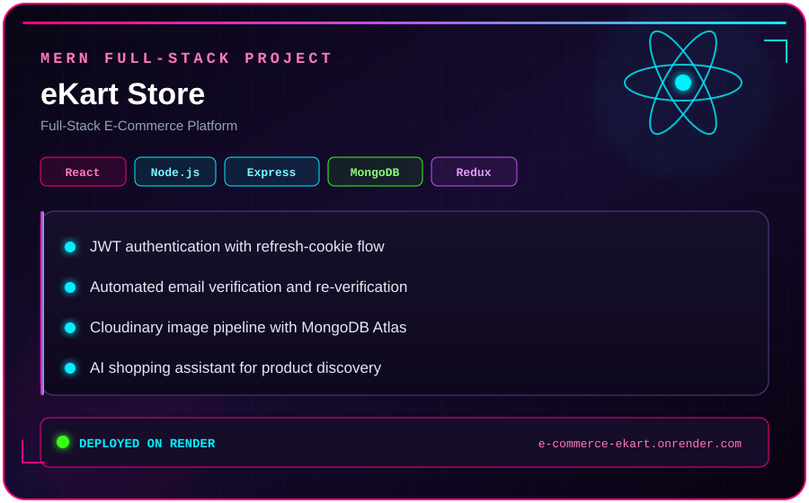
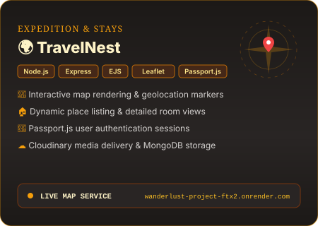
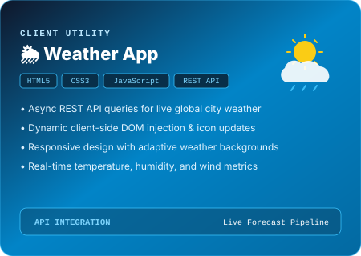
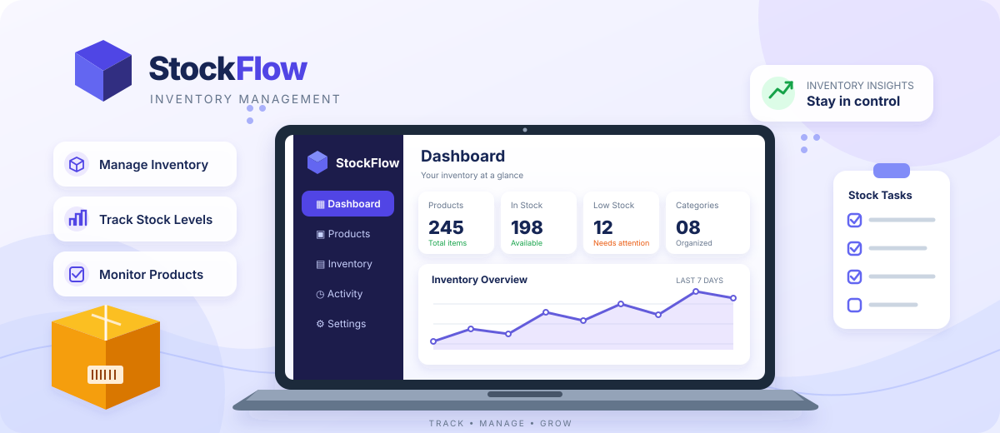
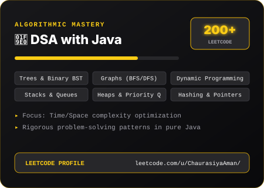

 <p align="center">
  
</p>

<p align="center">
  
</p>

# ⚡ Who Am I?

```java
public class AmanChaurasiya {

    private final String role = "Software Developer";
    private final String education = "B.Tech CSE | Class of 2027";
    private final String location = "India";

    private final String[] interests = {
        "Problem Solving with Java and DSA",
        "Full-Stack Development",
        "Backend Engineering",
        "Building Practical Software"
    };

    public String currentMission() {
        return "Building practical software, one commit at a time.";
    }

    public String nextGoal() {
        return "Keep learning, building, and improving.";
    }
}
```

<p align="center">
  <a href="https://www.linkedin.com/in/er-aman-chaurasiya/">
    
  </a>
  <a href="mailto:amanchaurasiya2207@gmail.com">
    
  </a>
  <a href="https://leetcode.com/u/ChaurasiyaAman/">
    
  </a>
  <a href="https://portfolio-website-omega-dusky-43.vercel.app">
    
  </a>
</p>

---

# 🛠️ Tech Universe

<p align="center">
  
</p>

---

# 💻 Tech Stack

### Languages

<p>
  
</p>

### Frontend

<p>
  
</p>

### Backend

<p>
  
</p>

### Database

<p>
  
</p>

### APIs & Authentication

<p>
  
  
  
</p>

### Tools

<p>
  
</p>

---

# 🚀 Featured Projects

<table>
<tr>
<td width="50%" valign="middle">

### 🛒 eKart - Full-Stack E-Commerce

A full-stack MERN e-commerce platform featuring JWT-based authentication, email verification, product management, Cloudinary integration, Redux Toolkit state management, and REST APIs.

**Tech:** React · Node.js · Express · MongoDB · JWT · Redux Toolkit · Cloudinary

**Live Demo:** <a href="https://e-commerce-ekart.onrender.com">eKart</a>

**Source Code:** <a href="https://github.com/chaurasiya-aman/eKart-frontend">Frontend</a> · <a href="https://github.com/chaurasiya-aman/eKart-backend">Backend</a>

</td>
<td width="50%" align="center" valign="middle">
  <a href="https://e-commerce-ekart.onrender.com">
    
  </a>
</td>
</tr>

<tr>
<td width="50%" align="center" valign="middle">
  <a href="https://wanderlust-project-ftx2.onrender.com/">
    
  </a>
</td>
<td width="50%" valign="middle">

### 🏡 TravelNest - Travel Listing Platform

A full-stack travel listing platform built with Node.js and Express, featuring user authentication, persistent sessions, image uploads, Cloudinary storage, interactive maps, and MongoDB integration.

**Tech:** Node.js · Express · MongoDB · EJS · Passport.js · Cloudinary · Leaflet

**Live Demo:** <a href="https://wanderlust-project-ftx2.onrender.com/">TravelNest</a>

**Source Code:** <a href="https://github.com/chaurasiya-aman/WanderLust-Project">GitHub</a>

</td>
</tr>

<tr>
<td width="50%" valign="middle">

### 🌦️ Weather App

A responsive weather application that retrieves weather information through an API and presents it through a clean, user-friendly interface.

**Tech:** HTML · CSS · JavaScript · Weather API

**Live Demo:** <a href="https://chaurasiya-aman.github.io/weather-app/">Weather App</a>

**Source Code:** <a href="https://github.com/chaurasiya-aman/weather-app">GitHub</a>

</td>
<td width="50%" align="center" valign="middle">
  <a href="https://chaurasiya-aman.github.io/weather-app/">
    
  </a>
</td>
</tr>

<tr>
<td width="50%" align="center" valign="middle">
  <a href="https://stockflow-0jd0.onrender.com/login">
    
  </a>
</td>
<td width="50%" valign="middle">

### 📦 StockFlow - Inventory Management System

An inventory management project designed to provide an interface for managing and tracking inventory.

  **Live Demo:** <a href="https://stockflow-0jd0.onrender.com/login">StockFlow</a>
  
  **Source Code:** <a href="https://github.com/chaurasiya-aman/StockFlow">GitHub</a>

</td>
</tr>
</table>

---

# 🧠 Data Structures & Algorithms

<p align="center">
  <a href="https://leetcode.com/u/ChaurasiyaAman/">
    
  </a>
</p>

<p align="center">
  <b>200+ LeetCode problems solved in Java</b><br/>
  Graphs · BFS · DFS · Topological Sort · Shortest Paths · Dynamic Programming · Binary Search · Trees
</p>

---

# 📚 Computer Science Fundamentals

<p align="center">
  
  
  
  
  
</p>

---

# 📊 GitHub Statistics

<p align="center">
  
  
</p>

<p align="center">
  
</p>

---

# 🐍 Contributions

<p align="center">
  <picture>
    <source
      media="(prefers-color-scheme: dark)"
      srcset="https://raw.githubusercontent.com/chaurasiya-aman/chaurasiya-aman/output/github-contribution-grid-snake-dark.svg"
    />
    <source
      media="(prefers-color-scheme: light)"
      srcset="https://raw.githubusercontent.com/chaurasiya-aman/chaurasiya-aman/output/github-contribution-grid-snake.svg"
    />
    
  </picture>
</p>

---

# 💡 Developer Quote

<p align="center">
  <i>"First, solve the problem. Then, write the code."</i>
</p>

---

# 🤝 Connect With Me

<p align="center">
  <a href="https://www.linkedin.com/in/er-aman-chaurasiya/">
    
  </a>
  <a href="mailto:amanchaurasiya2207@gmail.com">
    
  </a>
  <a href="https://github.com/chaurasiya-aman">
    
  </a>
</p>
